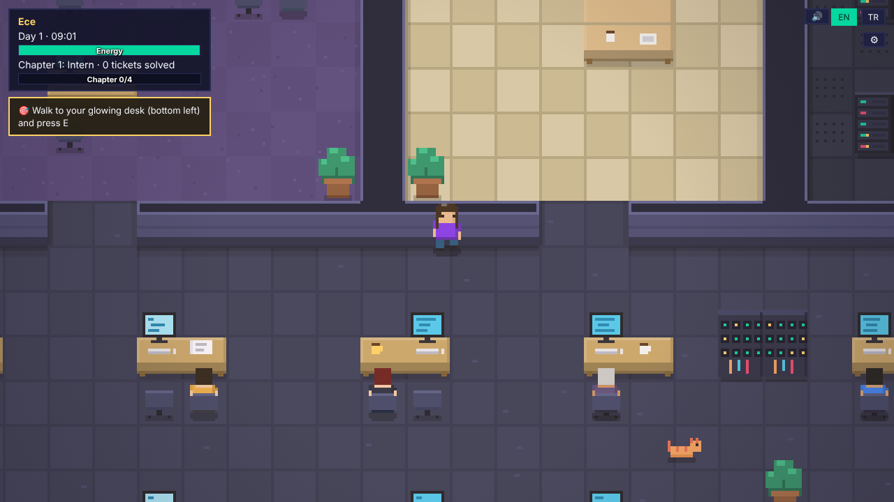
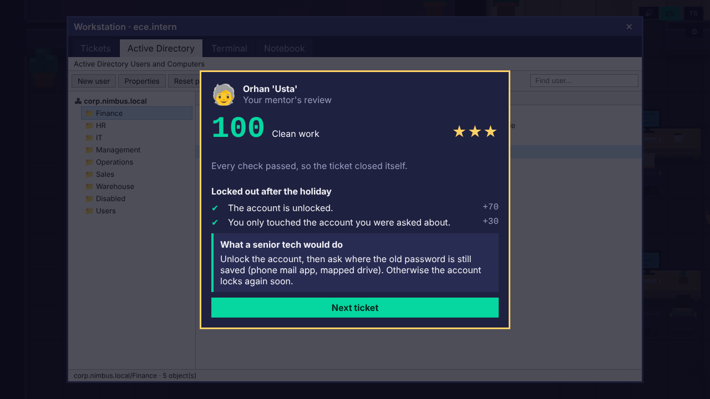
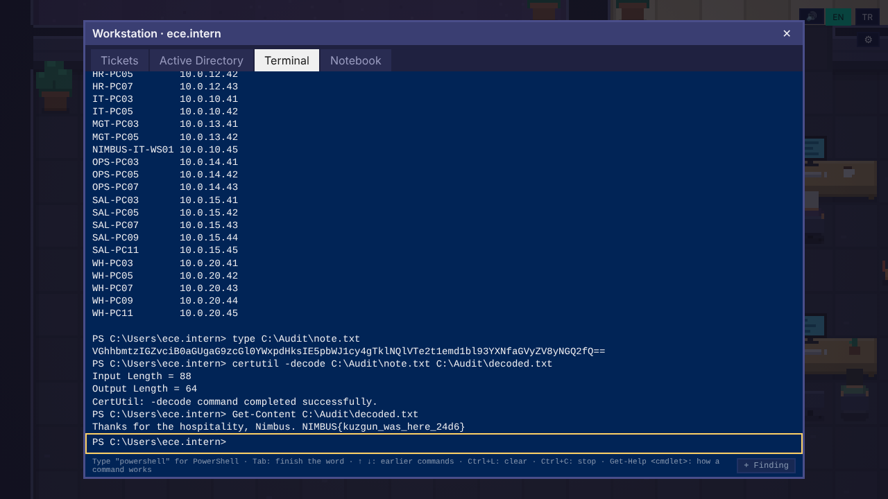

# Rookie Desk: Day One IT

**▶ Play the demo in your browser: https://ervakeskin.github.io/rookie-desk-play/**
Also on itch.io (comments, updates): https://ervakeskin.itch.io/rookie-desk

*Your first IT job, simulated. Then the logs start whispering.*

You are the new IT intern at Nimbus Logistics. Walk a pixel-art office, talk to coworkers who remember how you treat them, and close tickets with an Active Directory console and a working terminal (cmd and PowerShell). A mentor grades every ticket. The demo ends with your first CTF flag.

## What is in the demo (about 2 hours)
- Unlock accounts, reset passwords the right way, fix a pulled cable, clear a stuck print queue, catch a phishing mail and a fake "CEO" on the phone
- Real commands in a simulated environment: `Get-ADUser`, `Unlock-ADAccount`, `ipconfig`, `nslookup`, `Get-Process`, `Remove-PrintJob`, `certutil` and more
- Audit Week: first security cases, each with a short lesson and quiz
- Finale: hunt a trail through a VPN log and decode a base64 note into a CTF flag
- English and Turkish. Keyboard (WASD, E, 1-9, Esc) or touch.

Everything is fictional and runs in your browser. No real system is contacted and no data is collected; progress is saved in your browser only.

## Notes
- Built with TypeScript and Vite. This repository holds only the compiled demo; the source is private.
- Game page: https://ervakeskin.itch.io/rookie-desk · Contact: ervakeskinn04@gmail.com

## Türkçe
**▶ Demoyu tarayıcında oyna: https://ervakeskin.github.io/rookie-desk-play/**

Nimbus Lojistik'in yeni BT stajyerisin. Piksel ofiste dolaş, iş arkadaşlarınla konuş, ticket'ları Active Directory konsolu ve çalışan bir terminalle çöz. Demo yaklaşık 2 saat sürer ve ilk CTF bayrağınla biter. Oyun Türkçe ve İngilizce; her şey kurgusaldır ve tarayıcında çalışır.

---
© 2026 Erva Keskin. All rights reserved. Microsoft, Windows, PowerShell and Active Directory are trademarks of Microsoft; this project is not affiliated with them.
